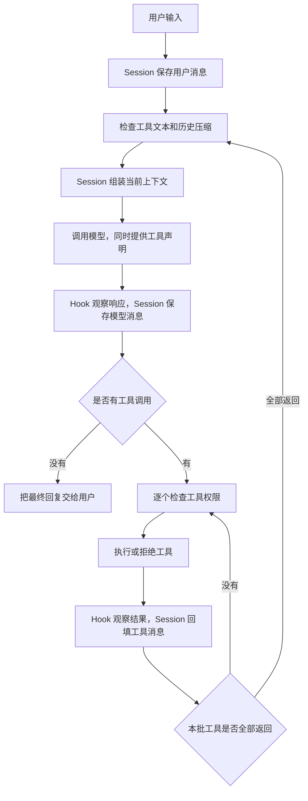

# 万物皆插件

> 从售后业务出发，由模型决定下一步，由代码执行工具、保存事实和管理上下文的轻量 Agent。

这个项目用于学习并跑通一个本地售后 Agent，提供命令行和轻量桌面窗口：用户提出问题，模型查询订单、读取规则、收集必要信息，再回答用户；需要申请退款时，先经过人工确认，再更新本地订单状态。

下面介绍的是**当前代码实际实现的流程**。第一次阅读可以先看第 1～5 节，理解完整对话；再看第 11 节，理解两种压缩。工具、Todo、Hook、子 Agent 和评估可以按需要逐节阅读。

流程导航：

- [启动](#4-启动流程)与[完整对话](#5-一轮完整对话如何运行)
- [Session 与上下文](#6-session-如何保存消息和组装上下文)
- [Skill 加载](#7-skill-如何按需加载)与[工具、审批、订单读写](#8-工具如何注册审批和执行)
- [Todo](#9-todo-如何记录计划)与[Hook](#10-hook-在什么时候运行)
- [两种压缩](#11-两种压缩如何运行)与[存储位置](#12-数据最终保存在哪里)
- [子 Agent](#13-子-agent-如何处理独立任务)与[退款串联示例](#14-一次退款咨询到申请的串联示例)
- [失败处理](#15-失败时当前会怎样)、[验证](#16-如何验证流程)与[项目结构](#17-项目结构与阅读顺序)

## 1. 如何运行

在项目根目录执行以下命令。项目依赖见 `requirements.txt`，主要是模型客户端、Pydantic 数据校验和环境变量加载。

### 安装依赖

```powershell
python -m pip install -r requirements.txt
```

也可以使用项目已有虚拟环境的 Python：

```powershell
& '.\.venv\Scripts\python.exe' -m pip install -r requirements.txt
```

### 配置密钥并启动

```powershell
$env:DEEPSEEK_API_KEY = "your-api-key"
python agent/main.py
```

`your-api-key` 需要替换为自己的密钥。模型配置模块会通过 `load_dotenv()` 加载 `.env`，也可以用这种方式配置。密钥不要写进源码或提交到 Git。

启动后输入售后问题；输入 `q`、`quit` 或 `exit` 退出，空输入会被忽略。启动交互后，处理问题会调用真实模型。

### 图形界面入口

安装和密钥配置沿用上面的步骤，在项目根目录执行：

```powershell
python gui.py
```

窗口支持聊天、处理中状态、操作确认、新对话和可展开的运行记录。界面使用 Python 自带的 Tkinter，通过独立进程转接现有命令行入口，后端代码保持原样。使用方式、数据走向和边界见 `GUI.md`。

当前项目在 `agent/model/model_pool.py` 中配置：

| 配置项 | 当前值 | 用途 |
| --- | --- | --- |
| `DEFAULT_MODEL` / `model_id` | `deepseek-v4-pro` | 选择配置，并作为请求的模型名称 |
| `base_url` | `https://api.deepseek.com` | 模型服务地址 |
| `api_key_env` | `DEEPSEEK_API_KEY` | 从哪个环境变量读取密钥 |

这里使用 OpenAI Python SDK 调用兼容接口。`MODEL_POOL` 当前是一个模型配置字典，尚未实现连接池、负载均衡或自动切换模型。

## 2. 先理解几个词

| 概念 | 在本项目中指什么 | 小例子 |
| --- | --- | --- |
| 会话 Session | 从程序启动到退出期间，持续保存的主对话状态 | 用户连续问了三个问题，仍用同一个 Session |
| 一轮用户对话 | 一条用户问题，以及处理它时产生的模型消息、工具结果和最终回复 | “查订单 1001”到最终回答 |
| 一次模型调用 | 把上下文交给模型，拿到一次响应 | 模型先要求查订单，读到结果后再次响应 |
| 一条消息 | 历史列表里的一个记录 | `user`、`assistant` 或 `tool` 消息 |
| 完整历史 history | 主对话中已经发生的动态消息原文 | 用户问题、工具调用、完整工具结果、模型回复 |
| 当前上下文 context | 这一次实际发送给模型的消息列表 | 系统提示 + Skill 短目录 + 处理后的历史窗口 |
| 工具调用 tool call | 模型提出的执行请求，包含名称、参数和调用 ID | `lookup_order(order_id="1001")` |
| 工具结果 tool result | 程序执行或拒绝该请求后，回填的文本 | 查询结果或“用户拒绝执行” |

**一轮用户对话可以包含多次模型调用和多个工具结果。** Hook 输出的 `round` 是模型调用轮次，不是压缩策略里按用户消息划分的轮次。

**完整历史和当前上下文是两份用途不同的数据。** 完整历史负责保留发生过什么；当前上下文负责提供模型这一次需要看到的信息。压缩只改变发送给模型的副本。

## 3. 各模块负责什么

| 模块 | 负责的事情 | 主要文件 |
| --- | --- | --- |
| 启动入口 | 选择模型、创建客户端、注册运行时工具、创建 Session、接收用户输入 | `agent/main.py` |
| 主循环 Loop | 调用模型、判断是否继续、经过权限检查执行工具、回填结果 | `agent/loop/agent_loop.py` |
| Session | 保存原始消息和两种压缩记录，检查工具配对，组装上下文 | `agent/session/session.py` |
| 压缩器 | 决定工具文本如何截短、历史何时裁剪和保留哪些轮次 | `agent/compact/window_compactor.py` |
| 压缩结果契约 | 规定替换范围、标记内容和预留归档路径的字段 | `agent/compact/contracts.py` |
| 工具 | 提供订单查询、规则读取、退款申请、计划记录和子任务入口 | `agent/tool/` |
| 订单存储 | 从 SQLite 读取和更新订单事实 | `agent/knowledge/facts/orderstore/order_store.py` |
| Skill 知识 | 提供政策、店规和处理指导；按需读取全文 | `agent/knowledge/skill/` |
| 权限中间件 | 决定工具直接执行、人工确认或拒绝 | `agent/middleware.py`、`agent/tool/permissions.py` |
| Hook | 在指定时机输出观察信息或附加提醒 | `agent/hooks/` |
| 子 Agent | 用独立消息列表完成一个子任务，返回最终文本 | `agent/tool/sub_agent.py` |
| 评估 | 用固定案例、临时订单数据库检查工具行为和回复 | `evals/run_eval.py` |

例如“保留首轮和最近三轮”属于压缩器的策略；“保存这个结果，并把它放进下一次上下文”属于 Session；“什么时候准备下一次模型请求”属于 Loop。

## 4. 启动流程

入口是 `agent/main.py` 中的 `main()`。客户端和 Session 在进入输入循环之前创建，后续每次提问都复用它们。

```text
加载模型配置和 Skill 注册表
  → 读取当前模型需要的 API Key
  → 创建模型客户端 client
  → configure_tools(client, model) 绑定 task 工具
  → 创建一个 Session，并传入 WindowCompactor
  → 进入命令行输入循环
```

具体过程：

1. 模型配置模块加载 `.env`，Skill 注册表扫描本地 `SKILL.md` 的元数据。
2. `main()` 从 `MODEL_POOL[DEFAULT_MODEL]` 取得模型名称、服务地址和密钥变量名。
3. 使用这些配置创建 `OpenAI` 客户端。缺少依赖或密钥时，启动会给出提示并停止。
4. 调用 `configure_tools(client, model)`。普通工具已经注册；`task` 需要共享客户端和模型，所以在此时绑定处理函数。
5. 创建 Session，传入系统提示、Skill 短目录和 `WindowCompactor()`。
6. 等待用户输入。退出指令结束程序；有效问题通过 `session.add_user(query)` 写入原始历史，然后进入主循环。

系统提示包含店铺身份、当前日期、查询订单要求、知识使用方式和业务执行边界。日期在加载入口模块时生成，当前没有跨午夜自动刷新提示的逻辑。

系统提示规定：订单工具结果优先于用户口述，法律规则优先于店规，案例不能替代当前订单事实。

## 5. 一轮完整对话如何运行

主循环每次请求模型前，都会先处理上下文。模型可能直接回答，也可能要求调用工具。



### 分支一：模型直接回答

例如用户说“你好”，模型返回普通文本，没有 `tool_calls`：

```text
user：你好
assistant：你好，请问需要处理什么售后问题？
```

Session 保存回复，Loop 返回它，`main()` 打印文本并等待下一条用户输入。程序用“没有工具调用”判断本轮结束，不靠回复中的某个结束词。

### 分支二：模型需要工具

例如用户要求查询订单。以下只是说明消息结构的示例，不代表订单 1001 的当前真实状态：

```text
user：帮我查一下订单 1001
assistant：请求 lookup_order，调用 ID 为 call_01
tool：查询结果，tool_call_id 为 call_01
assistant：根据查询结果解释订单状态
```

代码顺序如下：

1. `session.compact_if_needed()` 检查单条工具文本和历史窗口。
2. `session.build_context()` 返回本次模型消息。
3. Loop 调用 `client.chat.completions.create(...)`，把 `messages` 和 `tools=TOOLS` 一起交给模型。
4. 响应到达后触发 `PostModelResponse`，然后通过 `session.add_assistant(...)` 保存模型消息。
5. 如果包含工具调用，按返回顺序逐个处理，当前没有并发执行。
6. 每个调用先触发 `PreToolUse`，再经过权限中间件。
7. 执行或拒绝后触发 `PostToolUse`；如果 Hook 返回提醒，把提醒附在结果后面。
8. 用 `session.add_tool_result(tool_call.id, tool_result)` 保存结果。
9. 本批所有工具都得到结果后，回到第 1 步，再请求模型。

请求中的 `max_tokens=8000` 用于限制模型输出 token 数，和后面介绍的历史字符预算是两个参数。

## 6. Session 如何保存消息和组装上下文

### 保存的数据

Session 内部保留以下关系：

| 字段 | 保存什么 |
| --- | --- |
| `_inputs` | 系统提示和 Skill 短目录 |
| `_history` | 只追加的完整动态消息：用户、模型和工具消息 |
| `_pending_tool_calls` | 模型已经请求、尚未得到结果的工具调用 ID |
| `_compactor` | 注入的压缩器；不传时不启用压缩 |
| `_compaction_results` | 历次整段历史裁剪结果 |
| `_tool_compaction_results` | 原始消息位置到缩短工具文本的映射 |

这里的下划线表示内部字段。正常流程通过 `add_user()`、`add_assistant()`、`add_tool_result()` 写入，通过 `history` 等属性读取副本。

### 为什么工具调用要有 ID

一个模型响应可能要求查两个订单，结果需要对应各自的请求：

```text
assistant 请求：call_01 → 查询订单 1001
                call_02 → 查询订单 1002

tool 返回：tool_call_id=call_01 → 订单 1001 的结果
tool 返回：tool_call_id=call_02 → 订单 1002 的结果
```

Session 在保存模型消息时登记这两个待返回 ID，每保存一个工具结果就移除对应 ID。全部返回后，才能组装下一次上下文或继续接入模型消息。

因此，工具被拒绝时也要回填一条结果。它说明“没有执行”，同时让这次调用有明确的结束记录。

### 写入时的检查

- 用户消息不能为空；上一轮有最终回复且没有待返回工具时，才能追加新问题。
- 模型消息必须接在用户消息或工具结果之后；同一响应里的工具 ID 不能重复。
- 工具结果必须对应待返回 ID；不存在的 ID 或重复返回会被拒绝。
- 工具结果尚未全部返回时，不能组装主对话上下文，也不能检查压缩。

Pydantic 负责字段和类型校验，Session 负责消息先后关系与工具配对。这些检查不判断订单是否符合退款条件。

### `build_context()` 的组装顺序

```text
第 1 条 system：系统提示
第 2 条 system：Skill 短目录
动态历史副本：
  先替换过长工具结果的正文
  再用最新历史裁剪标记替换被省略的中段
  保留其余用户、模型和工具消息
```

工具声明通过请求的 `tools` 参数单独发送，不保存为 `_history` 里的消息。订单和规则全文只有被工具读取后，才作为工具结果进入历史。

`build_context()` 返回独立列表，不把它写回 `_history`。`session.history` 返回完整原文的深拷贝，所以修改这个副本不会修改会话内部记录。

当前按事件逐条记录：用户输入先保存，模型返回后保存模型消息，工具返回后保存工具消息。中途失败不会自动撤销整轮已保存的数据，也不会撤销已经提交的订单修改。

## 7. Skill 如何按需加载

知识分为订单事实、政策规则和处理指导：

```text
knowledge/
├── facts/           # 订单、物流和退款状态，通过业务工具查询
└── skill/
    ├── policy/      # 政策与店规
    └── skills/      # 如何查询、追问、判断和处理请求
```

### 第一步：启动时提供短目录

`agent/knowledge/skill/registry.py` 扫描 `SKILL.md` 开头的 `name`、`description` 和 `category`，建立名称到文件路径的注册表。它检查名称是否重复、元数据是否齐全，以及分类是否和所在目录一致。

Session 初始只接收 `skills_catalog()` 生成的目录，不把所有规则全文塞进系统提示。当前目录包括：

| Skill 名称 | 分类 | 内容用途 |
| --- | --- | --- |
| `seven-day-return-policy` | `policy` | 七天无理由退货规则 |
| `store-after-sales-policy` | `policy` | 店铺售后受理和处理规则 |
| `after-sales-handling` | `skills` | 查询、追问、判断、执行的指导与案例 |

### 第二步：模型选择需要的知识

模型根据目录描述提出调用，例如：

```text
load_skill(name="seven-day-return-policy")
```

### 第三步：工具读取全文并回填

`load_skill()` 校验名称，在注册表中找到可信文件位置，读取完整 `SKILL.md`，返回 `ok`、`name`、`category` 和 `content`。不存在的名称返回错误及可用名称，文件读取失败也返回错误。

结果经过 Loop 序列化，保存为一条工具消息，下一次模型请求就能看到规则。如果全文过长，它也会走单条工具结果截短流程。

读取政策只代表获得知识。真正修改订单，需要调用对应业务工具；当前没有对应操作工具的业务，只能解释规则、收集信息并交给人工处理。

## 8. 工具如何注册、审批和执行

### 工具的两个入口

| 入口 | 面向谁 | 保存什么 |
| --- | --- | --- |
| `TOOLS` | 模型 | 工具名称、用途和参数的 JSON Schema 声明 |
| `TOOL_HANDLERS` | Python 程序 | 工具名称到执行函数的映射 |

例如，模型看到 `lookup_order` 的声明后提出查询请求，程序再用同名 handler 执行。工具声明本身不会运行 Python 函数。

普通工具在 `agent/tool/__init__.py` 中注册；`task` 通过启动时的 `configure_tools()` 注册并绑定客户端和模型。

### 权限流程

主循环把工具调用交给 `approval_middleware(tool_call, execute_tool)`：

| 权限 | 当前工具 | 行为 |
| --- | --- | --- |
| `ALLOW` | `load_skill`、`lookup_order`、`todo_write`、`task` | 直接进入执行函数 |
| `ASK` | `request_refund` | 在终端显示工具和参数，等待人工确认 |
| `DENY` | 未配置权限的工具，或显式禁用的工具 | 返回禁用说明，不执行 |

`ASK` 接受 `y` / `yes` 或 `n` / `no`，其他输入会继续询问。拒绝会作为工具结果回填，模型应根据它说明操作没有完成。

模型判断“用户明确要求申请”和终端人工批准是两件事。权限中间件只控制是否允许执行，不检查退货期限、商品完好或其他业务资格。

### 参数解析和执行

允许执行后，`execute_tool()` 按以下顺序处理：

```text
取得工具名称
  → 把 arguments 从 JSON 字符串解析为字典
  → 按名称查找 TOOL_HANDLERS
  → handler(**arguments) 执行
  → json.dumps(...) 转成工具结果文本
  → 返回 Loop，由 Session 保存
```

JSON 解析失败或参数不是对象时返回 `INVALID_TOOL_ARGUMENTS`；找不到 handler 时返回 `UNKNOWN_TOOL`；执行中的 `TypeError`、`ValueError` 会转换成 `TOOL_EXECUTION_ERROR`。工具也可以主动返回自己的业务错误。

这些错误结果会交给模型，用于解释失败或修正参数。当前没有为所有网络、数据库和运行异常提供统一恢复逻辑。

### 订单查询流程

```text
模型请求 lookup_order(order_id)
  → ALLOW
  → 校验并去除订单号首尾空白
  → orderstore.get_order(order_id)
  → 查询 SQLite
  → 返回订单字段或 ORDER_NOT_FOUND
  → 保存为 tool 消息
  → 模型依据事实回答
```

订单字段包含订单号、商品名、购买日期、物流状态、签收日期和退款状态。具体订单事实来自数据库，用户描述和案例不能替代查询结果。

### 退款申请流程

预期业务过程是：模型查询订单、读取适用规则、确认必要信息和用户意图，然后提出退款申请。实际执行过程是：

```text
模型请求 request_refund(order_id)
  → ASK，终端人工批准
  → 校验订单号
  → orderstore.update_refund_status(order_id, "申请中")
  → SQLite 提交修改
  → 返回 ok、order_id 和 refund_status
  → 模型根据结果解释申请状态
```

当前 `request_refund()` **只检查订单号并更新本地状态，不自行校验七天无理由资格**。资格判断依赖模型读取规则，是否执行由人工审批控制。它没有连接电商平台或支付系统。

成功结果中的“申请中”表示本地退款申请状态已更新，不能据此声称退款完成、资金到账或平台审核通过。拒绝或订单不存在时，不会完成该状态更新。

### SQLite 如何初始化

订单存储第一次打开数据库时创建 `orders` 表。表为空时，从 `mock_orders.py` 写入模拟订单；已有非空表不会被种子数据覆盖。

默认数据库位置是 `agent/knowledge/facts/orders.db`，由工具实际访问时创建。状态修改会提交到 SQLite，因此重启程序后仍能查到已保存的订单状态。

## 9. Todo 如何记录计划

当任务包含多个步骤或多个订单时，模型可以调用 `todo_write()`，传入**完整计划列表**：

```json
{
  "todos": [
    {"content": "查询订单 1001", "status": "in_progress"},
    {"content": "判断退货条件", "status": "pending"}
  ]
}
```

每次调用用新列表替换当前计划；传入空列表表示清空。状态是 `pending`、`in_progress`、`completed`，最多 20 项，同时最多一项 `in_progress`，任务内容不能为空。

工具先校验完整列表，再替换 `_CURRENT_TODOS`。失败时返回 `INVALID_TODOS`，原计划保留；成功时返回规范化的完整列表。

Todo 记录计划，不代表查询或退款已经执行。当前计划存在工具模块的进程内全局列表里，尚未按 Session 隔离，主 Agent 和子 Agent 调用的是同一工具状态；结果会通过各自的工具消息进入上下文。当前没有独立的 Todo 读取工具，也没有把计划自动插入系统提示。

## 10. Hook 在什么时候运行

Hook 是 Loop 在指定时机调用的回调函数，注册位置是 `agent/hooks/__init__.py`。

| 事件 | 主循环触发时机 | 当前回调的作用 |
| --- | --- | --- |
| `PostModelResponse` | 模型返回后、保存模型消息前 | 打印模型调用轮次、工具数量和是否继续 |
| `PreToolUse` | 权限检查和执行之前 | 打印工具名和原始参数 |
| `PostToolUse` | 得到执行或拒绝结果后、回填之前 | 必要时提醒模型更新 Todo |

Todo 提醒按工具处理次数计数：连续三次没有调用 `todo_write` 时返回提醒；调用 `todo_write` 或发出提醒后清零。它不区分这三次调用是否发生在同一条用户问题里，计数目前保存在模块内存中。

主循环将 `PostToolUse` 返回的提醒附在工具结果文本后，Session 保存这个合并后的文本，下一次模型调用可见。前两个观察 Hook 只输出信息，不增加历史消息。

`trigger_hooks()` 按注册顺序运行；遇到第一个非 `None` 返回值就返回，不再继续调用后续回调。当前子 Agent 没有接入这套 Hook 流程。


## 11. 两种压缩如何运行

当前的“压缩”是确定性的文本截短和历史裁剪，**没有调用模型生成语义摘要**。完整原文继续保存在 Session 内存中。

### 11.1 什么时候检查

主 Loop 每次调用模型前，执行：

```python
session.compact_if_needed()
messages = session.build_context()
```

这样，刚返回的大工具结果会在下一次模型看到它之前得到处理。两项检查有固定顺序：

```text
复制原始动态历史
  → 检查并截短单条工具结果
  → 在这些短文本的基础上检查整段历史窗口
  → 校验结果
  → 保存两种压缩记录
  → build_context 组装模型上下文
```

工具调用必须全部返回才进入这一步。整段历史裁剪还要求最新一条消息是用户问题，所以只在新用户轮次开始时执行；单条工具结果检查则会在每次主模型请求前执行。

### 11.2 默认参数

参数位于 `WindowCompactor`：

| 参数 | 默认值 | 含义 |
| --- | --- | --- |
| `max_tool_result_chars` | `4_000` | 单条工具结果正文的最大字符数，包含省略说明；最小可配置值为 256 |
| `max_chars` | `20_000` | 当前动态历史窗口序列化后的字符预算 |
| `keep_recent_turns` | `3` | 保留最近的用户轮次，包含刚追加的当前问题；首轮另外保留 |

`max_chars` 的估算方式是 `len(json.dumps(messages, ensure_ascii=False, default=str))`。它计算动态消息及其 JSON 结构字符，**不是精确 token 数**，也没有计算系统提示、Skill 短目录、工具声明和预留输出。

如果要调整策略参数，修改 `main()` 创建压缩器的位置即可，例如：

```python
compactor=WindowCompactor(
    max_chars=20_000,
    keep_recent_turns=3,
    max_tool_result_chars=4_000,
)
```

### 11.3 单条工具结果过长

目的：应对某一次 `load_skill` 或其他工具返回了大段文本的情况。

```text
完整工具结果
  → 正文未超限：保留原文
  → 正文超限：保留开头 + 省略说明 + 结尾
  → 保存缩短文本，原始消息不改动
```

截短说明包含原文字符数、原始消息位置、原文仍在 Session 内存中，以及归档读取尚未接入。算法先给说明留出空间，再把剩余字符预算分配给开头和结尾，所以最终文本不会超过单条预算。

例如，原始动态历史下标为 2 的消息（第三条，Python 下标从 0 开始）是工具结果：

```text
_history[2]["content"]：完整工具原文
_tool_compaction_results[2]：开头片段 + 说明 + 结尾片段
```

组装上下文时，只替换这条工具消息的 `content`，保留它的 `role="tool"` 和 `tool_call_id`，仍对应原来的工具调用。

这里按文本位置截断，不理解业务含义，也不保证保留 JSON 内部结构。模型看到的是带说明的文本片段，不能据此推测中间被省略的规则或事实。

已保存的短文本会继续复用；未超限的结果不会新增截短记录。这个步骤不重新调用工具。

### 11.4 整段历史超过预算

目的：应对多轮对话累积了较多消息的情况。

压缩器按 `role="user"` 找到每轮起点。当当前动态窗口超过字符预算，且中间还有可省略的轮次时：

```text
压缩前：第 1 轮 | 第 2 轮 | 第 3 轮 | 第 4 轮 | 第 5 轮 | 第 6 轮当前问题

压缩后：第 1 轮 | 历史省略标记 | 第 4 轮 | 第 5 轮 | 第 6 轮当前问题
```

默认保留首轮和最近三轮，最近三轮包含当前问题。示例中的第 2、3 轮整段一起省略，工具请求、对应结果和最终回复不会只删掉其中一部分。

压缩器返回一个 `CompactionResult`：

| 字段 | 含义 |
| --- | --- |
| `start` | 被省略范围的第一个原始消息位置 |
| `end` | 被省略范围结束后的第一个位置 |
| `content` | 替换该范围的说明文本 |
| `archive_path` | 为以后文件归档预留的路径；当前策略返回 `None` |

范围采用 Python 切片形式 `[start, end)`：包括 `start`，不包括 `end`。例如 `[2, 10)` 表示省略 8 条消息，不是 8 轮对话。

Session 使用结果组装：

```python
history[:start] + [{"role": "assistant", "content": marker}] + history[end:]
```

标记说明省略条数、原始范围和原文位置；它是历史省略说明，没有总结被删掉的业务内容。当前没有文件归档或读取工具，依赖缺失信息时，应明确说明并向用户确认。

后续再次裁剪时，新结果仍指向完整原始历史的位置。当前上下文只应用最新一条结果，不把历次标记全部叠加进去，也不让被省略的原文同时重复进入上下文。

压缩器在以下情况返回 `None`，表示保持已有裁剪状态：窗口未超限、正在单轮工具处理中、轮次数不足、没有更大的可省略范围，或者新标记没有让窗口变短。

### 11.5 两个压缩储存字段

**这两个字段保存不同类型的结果，并不保存两份完整历史。**

| 内部字段 | 数据形式 | 对应的公开读取属性 | 上下文中的用法 |
| --- | --- | --- | --- |
| `_compaction_results` | `list[CompactionResult]` | `session.compaction_results`，返回记录副本组成的 tuple | 用最新记录把旧轮次替换成一条标记 |
| `_tool_compaction_results` | `dict[int, str]` | `session.tool_compaction_results`，返回字典副本 | 按原始位置替换工具正文 |

完整历史在第三个字段 `_history` 中，可以通过 `session.history` 读取副本。所有位置都对应这份只追加的历史，因此新消息追加后，旧记录的位置仍然稳定。

应用时先替换工具文本，再裁剪历史中段。如果某条工具消息已经随整轮省略，它的短文本也不会另外进入上下文。

### 11.6 谁决定，谁校验，谁保存

```text
Loop：准备下一次模型请求
  → Session：取出历史和已有压缩记录的副本
  → WindowCompactor：选择短文本与裁剪范围
  → Session：校验并保存结果
  → Session：组装模型上下文
  → Loop：调用模型
```

压缩器决定策略。Session 检查返回字段、范围是否在原始历史内、是否保留当前用户问题，以及替换后工具调用和结果是否完整配对。

一次检查中，两种新结果全部处理成功后才保存。若校验或压缩失败，保留原始历史和此前已保存的记录，不留下只保存了一半的新压缩结果。

### 11.7 压缩后仍然过大怎么办

**当前还没有最终总预算检查和超限停止逻辑。** 现有压缩可以减少内容，但不保证每个请求一定低于目标预算。

例如：

- 一轮工具链返回 6 条结果，即使每条已截到 4,000 字符，正文合计仍有 24,000 字符。
- 首轮或保留的最近几轮本身很大，裁掉中间历史后仍可能超限。
- 当前用户问题或模型回复过长，现有策略没有对它们单独截短。
- 系统提示、Skill 短目录和工具声明不在当前动态字符预算内。

当前代码仍会按已有流程发起请求，无法容纳时可能由模型服务报错。以后需要补的连接位置是：`build_context()` 得到最终消息后，发送前检查总预算，再决定继续、停止或要求缩小输入。这里描述的是后续处理位置，当前尚未实现。

## 12. 数据最终保存在哪里

| 数据 | 当前位置 | 程序退出后是否保留 |
| --- | --- | --- |
| 系统提示和 Skill 短目录 | Session 的 `_inputs` | 会话对象消失；下次启动重新构建 |
| 主对话原始消息与完整工具结果 | Session 的 `_history` | 否，只有内存记录 |
| 整段裁剪记录 | Session 的 `_compaction_results` | 否 |
| 单条工具短文本 | Session 的 `_tool_compaction_results` | 否 |
| 当前 Todo 和 Hook 计数 | 工具或 Hook 模块的内存变量 | 否 |
| 子 Agent 的中间消息 | 子任务函数里的独立列表 | 否，未提供保存或读取入口 |
| 订单与退款状态 | `agent/knowledge/facts/orders.db` | 是，SQLite 文件 |
| 政策与处理指导 | `agent/knowledge/skill/` 下的 `SKILL.md` | 是，项目文件 |
| 真实评估报告 | 默认 `evals/reports/` 下的 JSON 和 Markdown | 是，生成后保存在文件中 |

**订单数据库保存业务事实，当前没有保存对话历史。** 本项目没有接入 Redis，也没有把 Session 转存到 SQLite。

之前讨论的 L1 / L2 / L3，可以对应当前的数据关系：

```text
L1 当前工作上下文：build_context() 临时组装的消息
L2 压缩信息：历史省略标记和单条工具短文本
L3 完整历史：Session._history 中的原始消息和工具结果
```

三层目前都在会话内存里。`cache → index → storage` 是后续存储分层的思路，尚未实现文件存储和历史读取工具；不能把标记里的原文位置当作模型已经可以调用的读取接口。

`archive_path` 是预留连接点。填写一个路径不会创建文件，也不会让模型自动读到文件；当前 `WindowCompactor` 把该字段设为 `None`。

历史原文用于回答“当时发生了什么”，重新查询工具用于回答“现在是什么状态”。恢复过去的记录不应重新执行 `request_refund` 这类修改状态的操作。

## 13. 子 Agent 如何处理独立任务

当一个任务需要多次探索，而主对话只需要最终结果时，模型可以调用 `task`。父模型需要在参数中写明目标和必要事实，因为子 Agent 不读取父会话。

```text
父模型请求 task(task="明确的目标与必要事实")
  → ALLOW
  → 已绑定的 handler 复用客户端和模型
  → 创建独立 messages，第一条是 task 对应的 user 消息
  → 子模型判断并调用基础工具
  → 没有工具调用时返回最终文本
  → execute_tool 序列化该返回值
  → 父 Session 把它保存为 task 的工具结果
  → 父模型继续处理主任务
```

当前实现有以下具体边界：

- 一层同步委派，父 Loop 等待子任务完成。
- 子工具列表排除 `task`，不能继续委派子任务。
- 子任务使用独立列表，没有主 Session、系统提示或 Skill 短目录，也没有接入主对话的压缩和 Hook。
- 子任务复用基础工具和权限中间件，所以退款操作仍会要求终端确认；它也能修改同一订单数据库和 Todo 状态。
- 子消息列表只在子任务中使用，父历史只接收最终结果，不接收完整中间消息。
- 子循环最多请求模型 30 次。达到上限而没有最终回复时，当前隐式返回 `None`，外层会序列化为 `null`，尚未提供专门的上限错误说明。

独立消息列表隔离的是对话内容，业务数据库和工具模块状态仍然共享。

## 14. 一次退款咨询到申请的串联示例

下面是预期的数据走向，实际工具选择和调用次数由模型决定。示例不预设订单已经符合条件。

```text
用户：订单 1001 可以退吗？
  → 保存 user 消息
  → 模型请求 lookup_order
  → 查询 SQLite，保存完整 tool 结果
  → 模型按需请求 load_skill
  → 读取规则，保存完整 tool 结果
  → 如规则正文过长，下一次模型请求前保存短文本
  → 模型根据规则和事实判断；缺少信息就追问
  → 保存并输出 assistant 最终回复

用户：确认，请帮我申请。
  → 保存新的 user 消息
  → 请求前检查压缩并组装上下文
  → 模型确认意图和条件后请求 request_refund
  → 终端 ASK，人工批准
  → SQLite 将订单退款状态更新为“申请中”
  → 保存实际 tool 结果
  → 模型根据结果说明申请状态
  → 保存并输出 assistant 最终回复
```

如果用户只咨询资格，预期只查询和说明；如果拒绝终端审批，就回填拒绝结果。模型的一段承诺、Todo 的 `completed` 或读取到的规则都不能代替工具执行结果。

## 15. 失败时当前会怎样

| 情况 | 当前行为 |
| --- | --- |
| 缺少模型依赖或密钥 | 启动提示并停止 |
| 用户输入为空 | 命令行忽略；Session 写入接口也拒绝空白问题 |
| 订单不存在、Skill 名称不存在 | 工具返回错误，交给模型解释 |
| JSON 参数错误或 handler 参数不匹配 | 执行层返回错误文本，作为工具结果回填 |
| 工具权限被拒绝 | 不执行操作，回填拒绝或禁用说明 |
| 消息顺序或工具 ID 配对错误 | Session 抛出校验异常，拒绝本次写入 |
| 压缩结果不合法 | 不保存本次两类新压缩记录，异常向上传递 |
| 模型请求、数据库或其他未处理异常 | 可能向上传递并中断当前运行；主入口没有统一恢复流程 |

一次写入失败不会追加该条不合法消息，但此前成功保存的事件继续存在。当前没有整轮回滚、失败后的自动续接或业务操作撤销机制。

主 Loop 也没有项目层的最大模型调用次数限制；只有子任务和评估入口各有自己的次数上限。当前没有自行实现重试或恢复策略，客户端库本身的行为不等同于项目已有完整恢复流程。

## 16. 如何验证流程

### 离线单元测试

使用模拟客户端和临时数据验证消息关系、压缩、工具行为和评估逻辑，不调用真实模型：

```powershell
python -B -X utf8 -m unittest discover -s evals/tests -v
```

如果使用项目虚拟环境：

```powershell
& '.\.venv\Scripts\python.exe' -B -X utf8 -m unittest discover -s evals/tests -v
```

主要测试文件：

- `evals/tests/test_gui.py`：桌面输入输出转接、连续对话、真实审批与临时订单更新、窗口状态和会话切换。
- `evals/tests/test_session_compaction.py`：历史裁剪、单条工具截短、工具配对、原文保留和失败时的记录状态。
- `evals/tests/test_run_eval.py`：评估、订单修改和主流程相关行为。

### 只校验评估数据

```powershell
python evals/run_eval.py
```

没有 `--live` 时只检查评估集结构和案例选择，不调用模型，不生成真实运行报告。

### 用真实模型做业务评估

下面的命令会调用配置的模型，需要 API Key，并产生模型使用费用：

```powershell
python evals/run_eval.py --live
```

只运行一个案例：

```powershell
python evals/run_eval.py --live --case eligible_explicit_application
```

评估的流程是：

```text
读取案例与固定日期
  → 为案例创建独立 Session
  → 创建临时 SQLite，写入案例订单
  → 临时切换订单数据库路径和主 Loop 审批函数
  → 从 tool_approvals 模拟批准或拒绝
  → 调用主 Loop，记录工具轨迹、回复和日志
  → 比较工具序列、参数、订单前后状态和回复信号
  → 恢复数据库路径与审批函数，删除临时数据库
  → 保存 JSON 与 Markdown 报告
```

每个案例使用独立临时订单数据库，不修改日常运行的 `agent/knowledge/facts/orders.db`。`ASK` 工具从案例读取审批结果，不要求终端输入；未明确批准时不执行修改。

评估默认每个案例最多 8 次主模型请求，单次请求超时配置为 60 秒，可以通过 `--max-model-calls` 和 `--timeout` 调整。报告默认写入 `evals/reports/`，同时生成 JSON 数据和 Markdown 说明。

当前业务评估主要覆盖七天无理由退货流程，自动检查工具序列和参数、预期与意外订单修改，以及回复中的关键和禁止表述。词组匹配只是辅助信号，业务判断和表达仍需要人工复核。

当前评估创建 Session 时没有注入 `WindowCompactor`，也没有启动时的 `task` 注册步骤，所以业务评估不能视为主对话压缩或子 Agent 的完整验收；压缩由离线单元测试单独检查。详细案例范围和人工评分标准见 `evals/README.md`。

## 17. 项目结构与阅读顺序

```text
agent/
├── compact/
│   ├── contracts.py              # 压缩输入输出约定
│   └── window_compactor.py       # 裁剪轮次、截短工具文本
├── session/
│   └── session.py                # 原始历史、配对检查、上下文组装
├── loop/
│   └── agent_loop.py             # 主模型与工具循环
├── model/
│   └── model_pool.py             # 当前模型配置
├── tool/
│   ├── __init__.py               # 声明与 handler 注册
│   ├── permissions.py            # ALLOW / ASK / DENY
│   ├── lookup_order.py           # 查询订单
│   ├── request_refund.py         # 更新本地退款申请状态
│   ├── skill_tools.py            # 按名称读取 Skill
│   ├── todo_write.py             # 记录完整计划
│   └── sub_agent.py              # task 声明与子任务循环
├── hooks/                        # 轮次观察、工具观察、Todo 提醒
├── knowledge/
│   ├── facts/
│   │   ├── orderstore/           # SQLite 读写与模拟订单种子
│   │   └── orders.db             # 访问订单工具时生成的运行数据
│   └── skill/
│       ├── registry.py           # 扫描并生成 Skill 短目录
│       ├── policy/               # 政策和店规 SKILL.md
│       └── skills/               # 处理指导 SKILL.md
├── main.py                       # 启动组装与命令行输入
└── middleware.py                 # 工具审批流程

evals/
├── cases/seven_day_return.json   # 固定业务案例
├── tests/                        # 离线测试
├── reports/                      # 真实评估时生成
├── run_eval.py                   # 校验与真实评估入口
└── README.md                     # 评估范围与评分规则

requirements.txt                  # 项目依赖
gui.py                            # Tkinter 界面和独立进程终端转接
GUI.md                            # 图形界面使用说明与边界
DEVELOPMENT.md                    # 开发记录
AGENT.MD                         # 项目协作约定
```

建议顺着一条主线读代码：

1. `main.py`：看环境如何组装、用户输入从哪里进入。
2. `loop/agent_loop.py`：看模型如何选择直接回答或调用工具。
3. `session/session.py`：看消息如何保存、上下文如何组装。
4. `compact/window_compactor.py` 与 `contracts.py`：看压缩策略和结果字段。
5. `tool/lookup_order.py` 与订单存储：看一个工具如何把数据库事实交给模型。
6. 再按需要阅读审批、Skill、Todo、Hook、子任务和评估。

当前已跑通轻量主链路：用户输入 → 上下文组装 → 模型判断 → 权限检查 → 工具执行 → 结果回填 → 最终回复，并接入两种主对话压缩。

明确尚未实现的部分包括会话持久化、归档写入与读取工具、语义摘要、最终总预算拦截、真实平台退款接口、项目层的主循环次数上限和异常恢复。后续应根据实际业务失败案例逐步补充。
